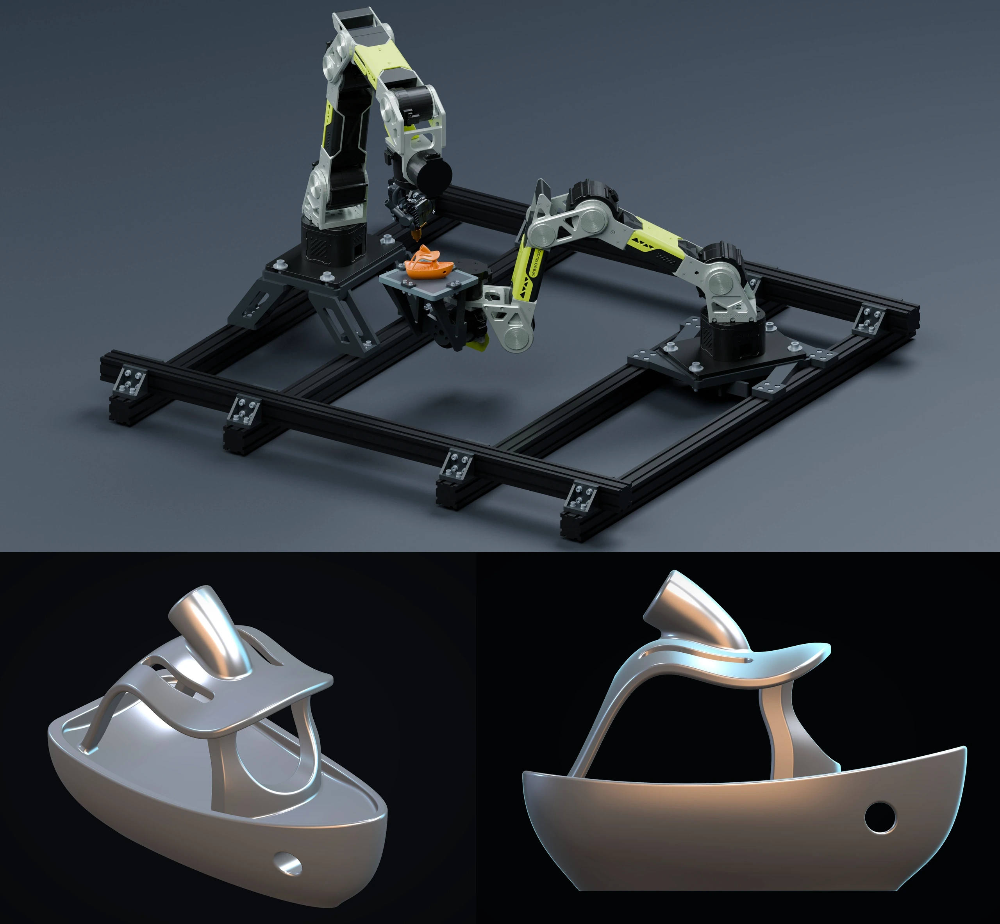
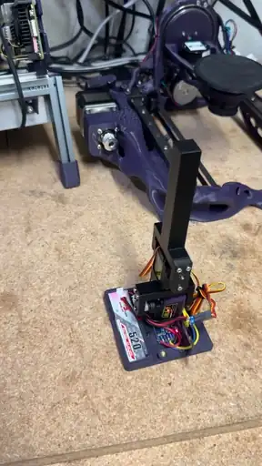
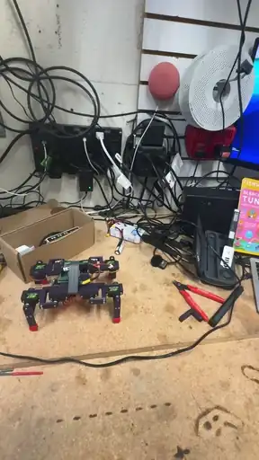
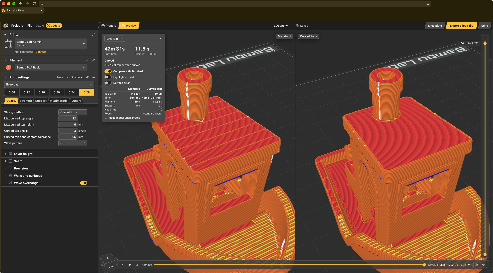
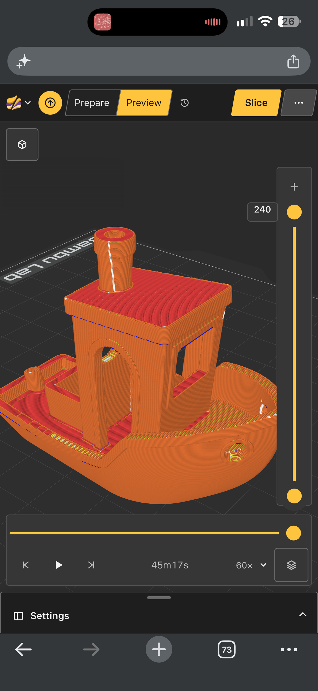
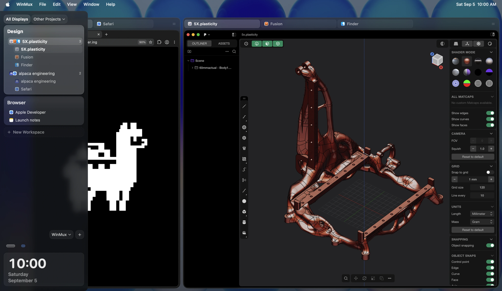
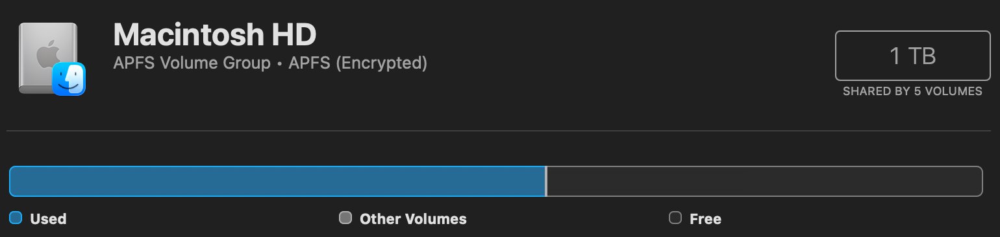
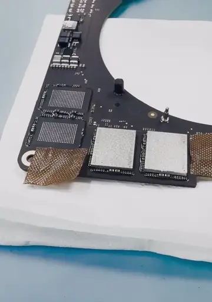
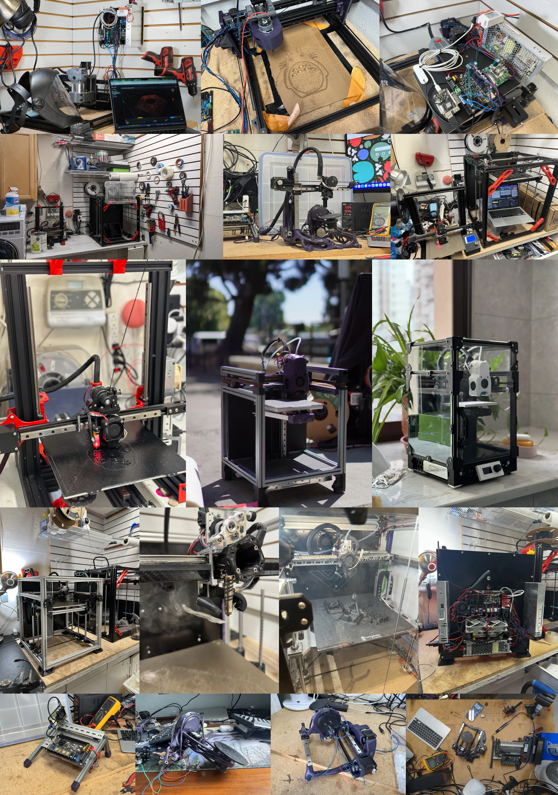
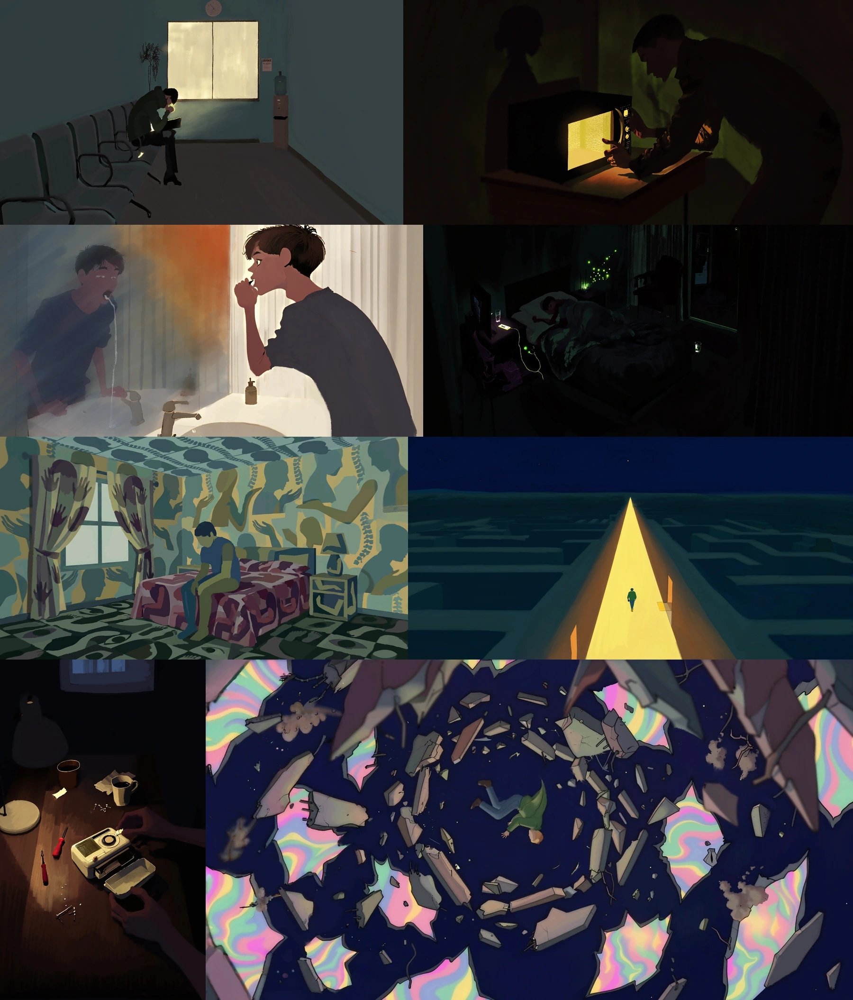

I really really like 3D printing1, anything electronic2, self-hosting3, and, depending on the month, a type of robotics4. I also work very hard to maintain my 6-hour P99 SLA on e-mail :)

**1.** Until it is "solved," my biggest dream is to help bring in a non-planar revolution (we can't let slicers stagnate!!) 
**2.** That is, microcontrollers, inverse kinematics, motion controllers, hardware hacking, machine learning (sorry for the buzzword), FPGA & ASIC design, algorithms, and probably a lot of things I'm forgetting. I also really enjoy working out and whiteboarding state machines 
**3.** I particularly enjoy satisfying web design and the thrill of opening a link to *.alpacawebservices.com, where most of my self hosted services live 
**4.** Currently, that is FOC & training robots with MuJoCo

## my favorite things that I {have, am, want} {worked, working, to work} on

Dual robot arm non-planar 3D printing

it turns out [these arms](https://www.seeedstudio.com/reBot-Arm-B601-RS-Assembled-Kit-with-Gripper-p-6865.html) are pretty bad for tracking accuracy. so i am looking into switching to this [unitree arm](https://shop.unitree.com/products/unitree-bionic-7-axis-dexterous-robotic-arm?variant=51885386760425) (also cheaper!)

  

(bottom: a benchy-derived test object I designed for measuring non-planar capabilities)

Robots!!

   

PancakeSlicer: self-hostable non-planar slicing for 3-axis, 5-axis, 6/7 (haha) DOF robot arms. <a href="https://pancake.cooking/">[link]</a>

some cool highlights

1. slice from any browser (phone, ipad, anything)
2. no need for tunneling services (bambu connect, etc) since it's self hosted and everything routes through your server
3. no need for syncing profiles between devices since its all server side
4. has the best profile management solution of any slicer in existence (IMO). iykyk no more having fifty slightly different `0.20mm STANDARD @BBL A1 mini 0.4mm` and whatnot. we use dynamic profiles -> auto-configure based on layer height and printer settings, so we only store the actual things you want in a profile (infill type, support, perimeter counts). this means you can use a profile, for the first time, *across* printers.
5. because it's built on web standards, things behave normally instead of on the (legendary, but really it's time to retire from) `wxWidgets` GUI framework. you know how copy pasting and even things like text selection don't work consistently? and how menus lag to open? yeah, that's all fixed now it's all the oh so beautiful web. i ❤️ web standards. and yes don't come at me it's built with electron (go look at webkit (safari) graphics performance and then come tell me you wouldn't do the same)

   

(in the left screenshot: planar slicing on the left, non planar on the right, you can see the difference in mean surface error)

(in the right screenshot you should be amazed that this is even possible!!)

WinMux: the bestest window manager ever <a href="https://winmux.dev/">[link]</a>

self explanatory, but

1. we have sidebars
2. we have ["window tabs"](https://www.winmux.dev/tab-groups.mp4) where you can stack multiple windows on top of each other and tab between them as if they are browser tabs
3. we have [double sided windows](https://www.reddit.com/r/MacOS/comments/1wed10s/double_sided_windows_in_winmux_054/) (yes, literally)
4. we have sidebars

A story in three acts

   
   
  

Printers &amp (one) <a href="https://github.com/ZimengXiong/ScrapNC/">CNC</a> I have designed/assembeled and built over the years

  

some art

  

